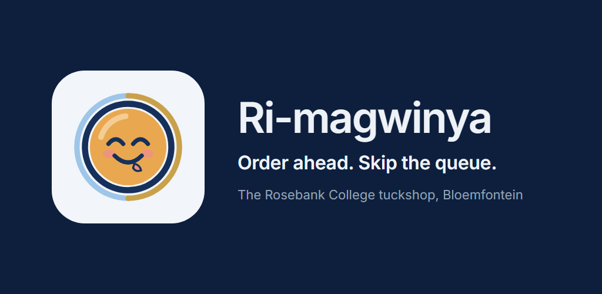
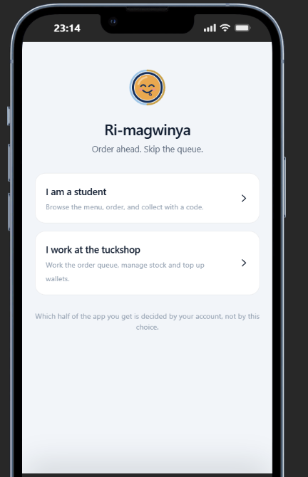
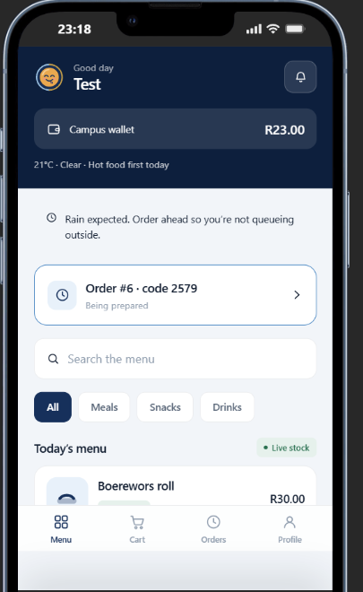
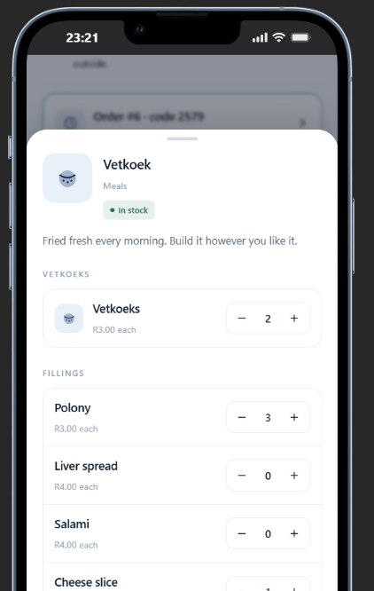
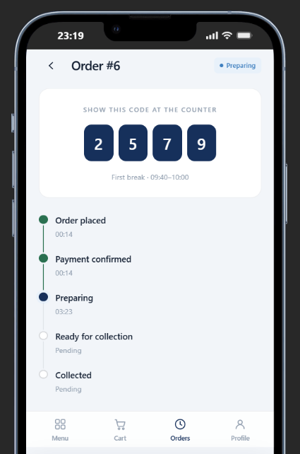
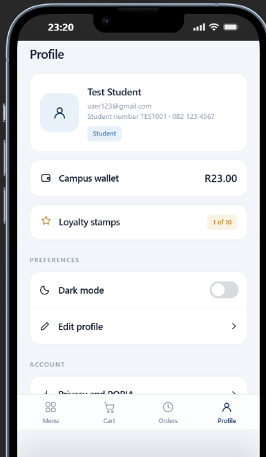

# Ri-magwinya



Ri-magwinya is an Android app for the tuckshop at **Rosebank College,
Bloemfontein**. Students order from their phone between lectures, pay from a
campus wallet, and collect at break with a four-digit code. Staff work a live
queue instead of guessing what's coming.

Built for **OPSC6312, Part 3 (final PoE)** by **Dylan Gorrah (ST10398445)**.
Version **1.1.0**.

| | |
|---|---|
| **Demo video** | <https://youtu.be/WvmOFFofuYo> |
| **Download the APK** | [Releases](https://github.com/Dylan-Gorrah/Ri-Magwinya/releases): the `.apk` under Assets |
| **Try it in a browser** | <https://dylan-gorrah.github.io/Ri-Magwinya/> |
| **Test accounts** | Student `user123@gmail.com` / `FrogybyD1` · Staff `admin@gmail.com` / `Admin1234!` |
| **Play Store material** | [`docs/play-store/`](docs/play-store/) |
| **How AI was used** | [`docs/AI-use.md`](docs/AI-use.md) |

---

## Contents

1. [The problem it solves](#the-problem-it-solves)
2. [Who it is for](#who-it-is-for)
3. [Features](#features)
4. [The PoE features](#the-poe-features)
5. [Design decisions](#design-decisions)
6. [Tech stack](#tech-stack)
7. [How to run it](#how-to-run-it)
8. [The backend](#the-backend)
9. [Tests](#tests)
10. [How we used GitHub and GitHub Actions](#how-we-used-github-and-github-actions)
11. [Logging](#logging)
12. [Release notes](#release-notes)
13. [References](#references)

---

## The problem it solves

At break, the queue takes the whole break. By the time you reach the counter
the vetkoek is finished, and the person behind the counter has no idea how many
people are still coming.

- **Students** see what's actually in stock, build their order the way they
  eat it, pay from a wallet, and collect with a code. No queue, no
  disappointment.
- **Staff** see each order the moment it's placed, with the full order written
  out, and move it along with one tap. They see what's selling, get an alert
  when stock runs low, and top up a student's wallet after a card payment.

## Who it is for

Two kinds of people share one app, and **the account decides which half you
get**.

- **Students:** menu, cart, checkout, order tracking, profile.
- **Tuckshop staff:** order queue, stock, sales, wallet top-ups.

The welcome screen has a Student card and a Staff card. They choose the sign-in
screen, not the role. The role comes from the database on every sign-in, so
staff who sign in on the student screen still land in the staff app, and a
student on the staff screen is refused.

**Staff accounts are made by the tuckshop manager, not in the app.** The staff
screen has no sign-up. The manager creates the user in Supabase under
*Authentication → Users* and sets the role:

```sql
update profiles set role = 'staff' where email = 'someone@example.com';
```

Every account made through the app is a student. The database enforces that
(`handle_new_user()` always writes `student`), and a SQL test checks that a
sign-up asking to be staff still gets a student.

---

## Features

| # | Feature | What it does | Where to look |
|---|---|---|---|
| 1 | **Live stock menu with server-priced ordering** | Stock updates on screen as it changes, sold-out items can't be ordered, and every price is worked out again on the server | `feature/menu/`, `domain/pricing/PriceCalculator.kt`, `supabase/migrations/0005_place_order.sql` |
| 2 | **Campus wallet** | Money comes off when you order; staff top up after a card payment on the speed point | `feature/cart/CheckoutViewModel.kt`, `feature/staff/TopUpViewModel.kt`, `supabase/migrations/0007_wallet_and_sales.sql` |
| 3 | **Staff order queue** | Live queue, one button per order, the full order as the student built it | `feature/staff/QueueViewModel.kt`, `supabase/migrations/0006_set_order_status.sql` |
| 4 | **Collection slots and the 4-digit code** *(marked in Part 3)* | Pick a break (first, second or afternoon) and see how full it is ("12 of 40 taken"). Each order gets a four-digit code, unique among the day's open orders, shown as tiles and checked by staff at the counter | `feature/cart/CartScreen.kt`, `feature/orders/OrderDetailScreen.kt`, `core/designsystem/component/OrderPieces.kt`, `next_collection_code()` in `supabase/migrations/0004_helpers.sql` |
| 5 | **Staff sales dashboard** *(marked in Part 3)* | Revenue, order count, average order, orders by hour as a chart with the peak marked, top sellers, and CSV export through the share sheet | `feature/staff/SalesScreen.kt`, `SalesChart.kt`, `SalesViewModel.kt`, `sales_summary()` in `supabase/migrations/0007_wallet_and_sales.sql` |

Features 1 to 3 were marked in Part 2. Features 4 and 5 come from the Part 1
design and are the two marked in Part 3.

**Also in the app:** building an order (vetkoeks plus fillings, chips sizes, tea
brand, milk and sugar, mixed sweets), live order tracking, cancelling until the
kitchen starts, pay-at-the-counter with a no-show limit, loyalty stamps, dark
mode, fingerprint unlock, a POPIA privacy page, and a weather-aware menu that
puts hot food first on a cold or rainy day.

## The PoE features

| Feature | How it works | Where to look |
|---|---|---|
| **Single sign-on (Google)** | "Continue with Google" on the student screens. Credential Manager gets a Google ID token; Supabase verifies it and signs the user in. A first Google sign-in asks for the student number before anything else. Cancelling the account sheet shows no error | `feature/auth/GoogleSignIn.kt`, `GoogleSignInViewModel.kt`, `ClaimStudentNumberScreen.kt`, `AuthRepository.signInWithGoogle()` |
| **Offline mode with sync** | Room caches the menu, slots, orders and weather. An order placed with no signal is queued, shows "Waiting for signal", and WorkManager sends it when the phone is back online. Its `client_ref` means a retry can never charge twice | `data/sync/SyncWorker.kt`, `SyncRepository.kt`, `core/database/` |
| **Real-time notifications** | Firebase Cloud Messaging, sent by the Edge Functions. The student gets "Order #… is ready" with the code. Staff get a low-stock alert when an order takes an item down to its reorder level. A top-up notifies the student. Tapping an order notification opens that order | `notifications/`, `supabase/functions/_shared/fcm.ts`, `order-status/`, `place-order/`, `load-wallet/` |
| **Multi-language** | English, Afrikaans and Sesotho. Per-app language that switches the whole app at once and survives a restart, on Android 7 and up | `res/values-af/`, `res/values-st/`, `res/xml/locales_config.xml`, `feature/profile/` |

Live updates (stock on the menu, the staff queue, a student's order) come from
Supabase Realtime.

---

## Design decisions

**The phone is never trusted with money, stock or roles.** Prices are
recalculated in SQL inside one transaction (`place_order`), which locks the item
and slot rows so two people can't both buy the last one. A student can't make
themselves staff: the role column can't be edited by its owner, and Row Level
Security is on every table.

**Money is whole cents.** Never `Double`, so there are no rounding errors. The
same pricing rules run in the app (`PriceCalculator`, for the live total) and on
the server (for the real charge). The five check values from the brief are unit
tests.

**One app, two roles.** Fewer screens to build, and one place where routing by
role happens (`SessionViewModel` and `RootNavHost`). The splash screen stays up
until the role is known, so nobody sees the wrong half of the app first.

**MVVM with one state per screen.** Each ViewModel exposes one `UiState`
through `StateFlow`, and composables only draw it. Every screen handles
loading, empty, error and success.

**Calm, minimal UI.** Neutral surfaces, one action colour (navy), and colour
only where it means something. Status is never shown by colour alone: every
pill has a text label. 48dp touch targets. Inter font, bundled.

**Retrofit for every endpoint.** Each PostgREST, Edge Function and weather call
is an explicit Kotlin interface, so it can be tested with MockWebServer.
`supabase-kt` is used only for sign-in and realtime.

**Offline first where it matters.** Repositories go to the network first and
fall back to Room, so the menu and your orders still open in a dead spot.

**Push never blocks an order.** A notification is a courtesy on top of the
in-app notification row. The Edge Function sends it after replying, and a failed
push never fails a request.

**App icon and store images** use the brand mark from the Part 1 prototype,
rendered by [`docs/play-store/src/render.py`](docs/play-store/src/render.py).


### Screenshots

| Welcome | Menu | Building a vetkoek | Order and code | Profile |
|---|---|---|---|---|
|  |  |  |  |  |
| Two cards; the account decides the role | Live stock, wallet, weather, the active order | Feature 1: built-to-order pricing | Feature 4: the code and live progress | Settings, wallet and loyalty |

The full screenshot list is in
[`docs/play-store/screenshots.md`](docs/play-store/screenshots.md).

---

## Tech stack

| Part | What we used |
|---|---|
| Language | **Kotlin** |
| UI | **Jetpack Compose** with Material 3, no XML layouts |
| Architecture | **MVVM** with a repository layer and one-way data flow |
| Dependency injection | **Hilt** (through KSP) |
| Async | **Coroutines**, `Flow`, `StateFlow` |
| Navigation | **Navigation Compose**, type-safe routes |
| REST client | **Retrofit** + **OkHttp** + **kotlinx.serialization** |
| Backend (SDK) | **Supabase**: Auth, PostgreSQL, PostgREST, Realtime, Edge Functions |
| Auth and realtime | **supabase-kt** (Auth and Realtime modules) |
| Local storage | **Room** (cache and offline queue), **DataStore** (settings) |
| Background work | **WorkManager** |
| Push | **Firebase Cloud Messaging** |
| Single sign-on | **Credential Manager** with Google ID |
| Biometrics | **androidx.biometric** |
| Charts | **Vico** |
| Weather | **Open-Meteo** (free, no key) |
| Tests | **JUnit**, **MockK**, **Turbine**, **MockWebServer**, coroutines-test |
| CI | **GitHub Actions** |
| Min / target SDK | 24 (Android 7) / 36 |

---

## How to run it

### The quickest look

Install the APK from [Releases](https://github.com/Dylan-Gorrah/Ri-Magwinya/releases)
on an Android phone (allow installing from that source when asked), or open the
[browser version](https://dylan-gorrah.github.io/Ri-Magwinya/). Both use the same
live database. Sign in with a test account above, or register. Any email works;
there is no college domain to match.

### Build it yourself

You need **Android Studio** and **JDK 17**.

1. Clone it:
   ```
   git clone https://github.com/Dylan-Gorrah/Ri-Magwinya.git
   ```
2. Create `local.properties` in the project root. It's gitignored, so it isn't
   in the repo:
   ```properties
   sdk.dir=C\:\\Users\\<you>\\AppData\\Local\\Android\\Sdk
   SUPABASE_URL=https://jykswltsegssjmvnqqbi.supabase.co
   SUPABASE_ANON_KEY=<publishable key from Supabase → Project Settings → API keys>
   GOOGLE_WEB_CLIENT_ID=<Web client ID from Google Cloud → Credentials>
   ```
3. For push, put `google-services.json` from Firebase in `app/`. It's also
   gitignored.
4. Plug in a phone with USB debugging on, and press **Run**.
   ```
   ./gradlew assembleDebug        # build
   ./gradlew testDebugUnitTest    # 182 unit tests
   ./gradlew bundleRelease        # signed AAB (needs the release key)
   ```

**Without any of these the app still builds.** It shows "Backend not
configured", hides the Google button, or switches push off. Nothing is
hardcoded in Kotlin.

---

## The backend

One hosted **Supabase** project.

**Tables:** `profiles` · `menu_items` · `option_groups` · `options` ·
`collection_slots` · `orders` · `order_items` · `stock_movements` ·
`wallet_transactions` · `notifications` · `loyalty_stamps`

**Row Level Security on every table.** A student sees their own orders; staff
see all of them. Anyone signed in reads the menu; only staff change it. Nothing
writes orders, stock or balances directly. There are no insert or update
policies on them, so the only way in is through these functions:

| We wrote | What it does |
|---|---|
| `place_order()` | One transaction: locks the rows, recomputes every price, checks stock, the slot and the wallet, makes a unique code, writes the order, deducts stock and money. The same `client_ref` twice returns the same order |
| `set_order_status()` | Owns the order steps, so nobody can skip one or un-collect an order. Refunds and restores stock on a cancel |
| `load_wallet()` | Staff only. Writes the ledger and the balance together |
| `adjust_stock()` | Stock as a change, never a total, so a sale made mid-tap isn't wiped out |
| `sales_summary()` | The whole sales screen, added up in SQL |

**Edge Functions** (`place-order`, `order-status`, `load-wallet`) wrap those.
They check the caller and the body, turn failures into clear codes like
`OUT_OF_STOCK`, `SLOT_FULL` and `INSUFFICIENT_FUNDS`, and send the pushes.

**Keys.** The app has the publishable key only, from `local.properties` through
`BuildConfig`. The secret key and the Firebase service account live in Edge
Function secrets, never in the app or the repo.

All SQL is in `supabase/migrations/`, numbered and run in order.

---

## Tests

**182 unit tests**, plain JUnit in `app/src/test`. No emulator needed.

| What they cover | Tests |
|---|---|
| Pricing, every check value in the brief | 21 |
| Checkout rules: slots, payment, refusals, what goes on the wire | 18 |
| Login and sign-up: staff screen, a student on the staff screen, wrong password, no signal, double tap, the sign-up form | 17 |
| Live stock updates and menu mapping | 14 |
| Weather thresholds, codes and cache | 13 |
| Validation: email, password, student number, phone | 12 |
| Cart, over a fake database | 12 |
| Staff: queue steps, item editor, sales, CSV | 12 |
| Profile, settings, editing your details | 12 |
| Edge Function contract, with MockWebServer | 11 |
| Money | 8 |
| Order progress and mapping | 8 |
| Offline queue | 7 |
| Menu screen state, with Turbine | 7 |
| Top-up screen | 6 |
| Session: a late profile can't switch roles; routing waits for the role check | 4 |

The database has its own tests too: `supabase/tests/run.sh` applies every
migration to a throwaway Postgres and checks **36** rules, including that a
sign-up can't ask to be staff.

---

## How we used GitHub and GitHub Actions

**Git.** Work went in phase by phase, each phase a small commit with a clear
message, such as `feat(auth): separate staff sign-in and fix the login glitches`
or `fix(nav): ignore double taps on links and Back`. Releases are tagged
(`v1.0.0`, `v1.0.1`), and the final hand-in is tagged `final-poe`. Secrets
(`local.properties`, `google-services.json`, the keystore) are in `.gitignore`
and have never been committed.

**GitHub Actions.** [`.github/workflows/build.yml`](.github/workflows/build.yml)
runs on every push and pull request to `main`:

1. Check out the code, then set up JDK 17 and Gradle caching.
2. Write `google-services.json` from a secret, so the CI build has push.
3. Run the **unit tests**.
4. Build the **release-signed APK** with the key from secrets, or a debug APK
   when those secrets aren't there.
5. Upload the APK as an artifact.
6. On a `v*` tag, publish it to **Releases**.

The build never needs `local.properties`. It reads each key from that file,
then from the environment, then falls back to empty, so CI can't fail just
because the file is missing.

**Secrets used** (repo → Settings → Secrets and variables → Actions):
`SUPABASE_URL`, `SUPABASE_ANON_KEY`, `GOOGLE_WEB_CLIENT_ID`,
`GOOGLE_SERVICES_JSON` (base64), `RELEASE_KEYSTORE_BASE64`,
`RELEASE_STORE_PASSWORD`, `RELEASE_KEY_ALIAS`, `RELEASE_KEY_PASSWORD`.

---

## Logging

Every class logs under its own tag starting with `Rm`. Filter Logcat by `Rm` and
it reads as a story: `RmAuth` signs in, `RmSession` routes by role, `RmMenu`
loads from Supabase or the cache, `RmCheckout` and `RmOrders` place the order,
`RmQueue` moves it, `RmSync` replays offline orders, and `RmPush` handles
notifications. `Log.d` is the normal flow; `Log.e` is a failure.

Passwords, tokens, keys and email addresses are never logged.

---

## Release notes

### v1.1.0 · Part 3, final PoE (5 November 2026)

**New features**

- **Google sign-in switched on** for students, in the release APK as well as
  debug builds.
- **Push notifications switched on:** "your order is ready" with the code, and
  wallet top-ups. Also **new**: **low-stock alerts to staff** when an order
  takes an item down to its reorder level.
- **Separate staff sign-in:** email and password only, with no sign-up. A
  student account on the staff screen is refused.
- **Features 4 and 5** written up and marked: collection slots with the
  four-digit code, and the staff sales dashboard.
- **Logging** across the app under `Rm` tags, with guide references in the
  code.
- **New app icon**, the 512 Play icon, the feature graphic, and a
  [`docs/play-store/`](docs/play-store/) folder with the listing and privacy
  policy.

**Fixed**

- The welcome screen flashed before the app opened for someone already signed
  in.
- A double tap opened a screen twice, and two taps on Back could leave a blank
  screen.
- The sign-in button came back to life before routing, so a second tap signed
  in twice.
- The keyboard's Next and Done keys did nothing on the sign-in forms.
- With fingerprint unlock on, signing in or out could try to navigate before
  the screens existed.

### v1.0.2 (13 October 2026)

- Fixed staff sometimes landing in the student app: a slow profile answer from
  the last user could arrive after the next sign-in.
- Fixed the app jumping back to the menu whenever the wallet balance changed,
  for example straight after placing an order.
- Sign-out now works with no signal, and a brief signal drop no longer signs
  you out.

### v1.0.1 (23 September 2026)

- Staff can find a student by number **or** name, and see the wallet before
  topping up.
- The browser version loads your own profile. It used to pick the first row,
  which put staff into the student view.
- GitHub Actions signs the APK with the release key and publishes it to
  Releases.

### v1.0.0 · Part 2 (22 September 2026)

The first real app, built from the Part 1 design. It had:

- the live stock menu, building an order, and cart and checkout with collection
  slots
- the campus wallet, and live order tracking with the code
- for staff: the queue, stock, sales and top-ups
- profile and settings, offline mode, three languages and the weather-aware
  menu
- a real Supabase backend with Row Level Security

Google sign-in and push were built but switched off until Firebase and Google
Cloud were set up.

### Prototype · Part 1 (August 2026)

An HTML prototype ([`docs/rimagwinya-prototype.html`](docs/rimagwinya-prototype.html))
with every screen and interaction, on demo data. It set the role from the card
you tapped, priced orders on the phone, and let the student mark an order
collected. The real app changed all three: the role comes from the server,
prices are worked out on the server, and only staff mark an order collected,
after checking the code.

---

## References

Written in IIE Harvard style, and repeated in the code next to whatever they
informed.

- Google. 2026. *Android developers guide.* [Online]. Available at:
  <https://developer.android.com/guide> [Accessed 22 September 2026].
- Google. 2026. *Jetpack Compose documentation.* [Online]. Available at:
  <https://developer.android.com/develop/ui/compose/documentation>
  [Accessed 22 September 2026].
- Google. 2026. *Log.* [Online]. Available at:
  <https://developer.android.com/reference/android/util/Log>
  [Accessed 5 November 2026].
- Google. 2026. *Splash screens.* [Online]. Available at:
  <https://developer.android.com/develop/ui/views/launch/splash-screen>
  [Accessed 5 November 2026].
- Google. 2026. *Navigate to a destination.* [Online]. Available at:
  <https://developer.android.com/guide/navigation/use-graph/navigate>
  [Accessed 5 November 2026].
- Google. 2026. *Authenticate users with Sign in with Google.* [Online].
  Available at: <https://developer.android.com/identity/sign-in/credential-manager-siwg>
  [Accessed 5 November 2026].
- Google. 2026. *Getting started with WorkManager.* [Online]. Available at:
  <https://developer.android.com/develop/background-work/background-tasks/persistent/getting-started>
  [Accessed 5 November 2026].
- Google. 2026. *Firebase: Receive messages in an Android app.* [Online].
  Available at: <https://firebase.google.com/docs/cloud-messaging/android/receive>
  [Accessed 5 November 2026].
- Supabase. 2026. *Supabase documentation.* [Online]. Available at:
  <https://supabase.com/docs> [Accessed 22 September 2026].
- Supabase. 2026. *Row Level Security.* [Online]. Available at:
  <https://supabase.com/docs/guides/database/postgres/row-level-security>
  [Accessed 22 September 2026].
- Supabase. 2026. *Kotlin: Create a new user.* [Online]. Available at:
  <https://supabase.com/docs/reference/kotlin/auth-signup>
  [Accessed 5 November 2026].
- Supabase. 2026. *Kotlin: Sign in a user.* [Online]. Available at:
  <https://supabase.com/docs/reference/kotlin/auth-signinwithpassword>
  [Accessed 5 November 2026].
- Supabase. 2026. *Kotlin: Sign in with ID token.* [Online]. Available at:
  <https://supabase.com/docs/reference/kotlin/auth-signinwithidtoken>
  [Accessed 5 November 2026].
- Square. 2026. *Retrofit.* [Online]. Available at:
  <https://square.github.io/retrofit/> [Accessed 22 September 2026].
- Patryk Goworowski. 2026. *Vico charts.* [Online]. Available at:
  <https://patrykandpatrick.com/vico/wiki/> [Accessed 22 September 2026].
- Open-Meteo. 2026. *Weather forecast API.* [Online]. Available at:
  <https://open-meteo.com/en/docs> [Accessed 22 September 2026].
- GitHub. 2026. *Building and testing Java with Gradle.* [Online]. Available
  at: <https://docs.github.com/en/actions> [Accessed 22 September 2026].
- Anthropic. 2026. *Claude* [Large language model]. Available at:
  <https://claude.ai> [Accessed 5 November 2026].
- Anthropic. 2026. *Claude Code.* [Online]. Available at:
  <https://www.anthropic.com/claude-code> [Accessed 5 November 2026].

How AI was used, and how it is cited, is in [`docs/AI-use.md`](docs/AI-use.md).

---

## How the code is laid out

```
app/src/main/java/com/rimagwinya/app/
├── core/           theme and components, money, network, database, settings
├── data/           remote (Retrofit + DTOs), repository, sync
├── domain/         model, pricing
├── feature/        auth, menu, cart, orders, staff, profile, notifications
├── navigation/     one NavHost: auth, student and staff graphs
└── notifications/  Firebase messaging service, channels
supabase/
├── migrations/     the database, in order
├── functions/      place-order, order-status, load-wallet
└── tests/          SQL tests against a throwaway Postgres
docs/
├── play-store/     listing, privacy policy, icon, feature graphic, screenshots
├── AI-use.md       how AI was used
└── APP_OVERVIEW.md a plain-English overview
```
